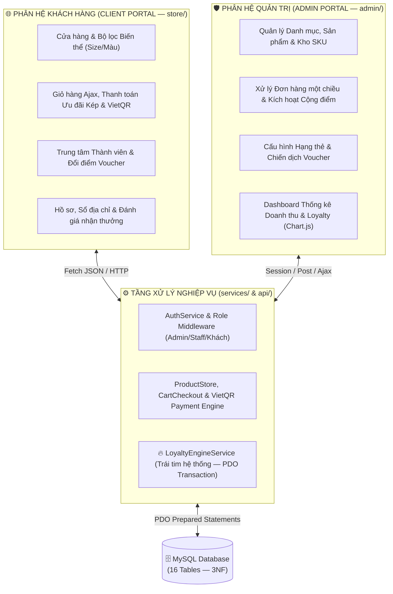
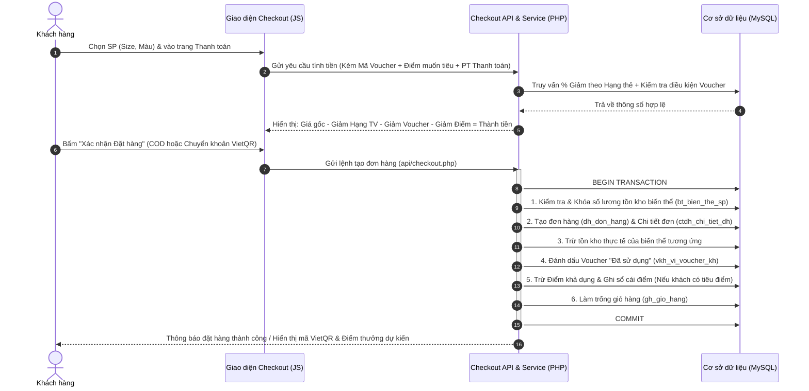
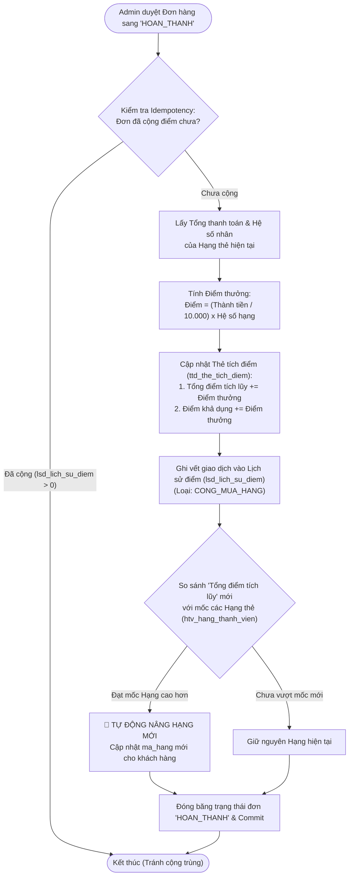
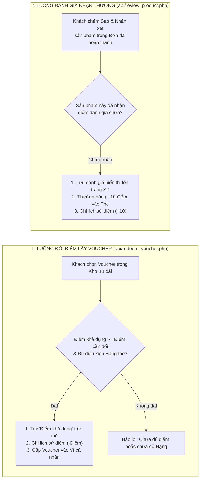

## Quản lý cửa hàng quần áo - khách hàng thân thiết

-777BB4?style=flat-square&logo=php&logoColor=white)
-4479A1?style=flat-square&logo=mysql&logoColor=white)
-38B2AC?style=flat-square&logo=tailwindcss&logoColor=white)
[](https://www.figma.com/design/3j4jEsrOaAWLzelLkLEzSd/Untitled?node-id=0-1&m=dev&t=Fqgx47g0xfbNDQEw-1)


> **Đồ án Môn học Quản lý Dự án Phần mềm — Nhóm 11 (Khoa CNTT — Đại học An Giang)**
> Hệ thống quản lý bán lẻ quần áo đa biến thể (Size/Màu sắc) tích hợp động cơ tích điểm, xét nâng hạng tự động, thanh toán **VietQR** và ví ưu đãi khách hàng thân thiết (**Customer Loyalty Engine**).
>
> 🔗 **Thiết kế Giao diện UI/UX (Figma):** [Mở bản thiết kế AURA STUDIO trên Figma](https://www.figma.com/design/3j4jEsrOaAWLzelLkLEzSd/Untitled?node-id=0-1&m=dev&t=Fqgx47g0xfbNDQEw-1)

---

## 📖 MỤC LỤC
1. [Bối cảnh & Mục tiêu Dự án](#-1-bối-cảnh--mục-tiêu-dự-án)
2. [Kiến trúc Hệ thống, Giao diện Figma & Phân hệ Chức năng](#-2-kiến-trúc-hệ-thống-giao-diện-figma--phân-hệ-chức-năng)
3. [Luồng Nghiệp vụ Trọng tâm (Core Workflows)](#-3-luồng-nghiệp-vụ-trọng-tâm-core-workflows)
4. [Tổ chức Cơ sở Dữ liệu (Tổng quan 16 Bảng)](#-4-tổ-chức-cơ-sở-dữ-liệu-tổng-quan-16-bảng)
5. [Kế hoạch Triển khai Dự án (WBS 5 Phases — 77 Ngày)](#-5-kế-hoạch-triển-khai-dự-án-wbs-5-phases--77-ngày)
6. [Cấu trúc Mã nguồn](#-6-cấu-trúc-mã-nguồn)
7. [Hướng dẫn Cài đặt & Kịch bản Trình diễn Demo](#-7-hướng-dẫn-cài-đặt--kịch-bản-trình-diễn-demo)

---

## 🎯 1. BỐI CẢNH & MỤC TIÊU DỰ ÁN

Trong lĩnh vực bán lẻ thời trang, việc thu hút khách hàng mới tốn kém gấp nhiều lần so với việc giữ chân khách hàng cũ. Dự án này hiện thực hóa các tài liệu đặc tả (*Báo cáo Quản lý Phạm vi, Điểm Use Case 123 UCP, Điểm chức năng, Phụ lục C & Kế hoạch MS Project 77 ngày*) thành một ứng dụng Web hoàn chỉnh với 3 trụ cột nghiệp vụ:

* **Cơ chế Tích điểm Kép & Nâng hạng Tự động (Automated Loyalty Tiering):** Tách bạch giữa **Điểm xét hạng** (tích lũy trọn đời để thăng cấp Đồng $\rightarrow$ Bạc $\rightarrow$ Vàng $\rightarrow$ Kim Cương) và **Điểm khả dụng** (dùng như tiền tệ để đổi Voucher hoặc giảm trừ hóa đơn).
* **Khuyến mãi Đa tầng & Thanh toán VietQR (Multi-layer Checkout):** Cho phép khách hàng hưởng đồng thời đặc quyền giảm giá tự động theo Hạng thẻ hiện tại kết hợp với Phiếu giảm giá (Voucher) trong ví cá nhân, hỗ trợ thanh toán COD và chuyển khoản mã **VietQR** động.

---

## 🏗️ 2. KIẾN TRÚC HỆ THỐNG, GIAO DIỆN FIGMA & PHÂN HỆ CHỨC NĂNG

Hệ thống được thiết kế theo kiến trúc **Client-Server 3 tầng (Presentation — Service Layer — PDO/MySQL)** sử dụng **PHP 8.x thuần kết hợp Tailwind CSS & Fetch API (Ajax)** để đảm bảo trải nghiệm mượt mà không cần tải lại trang ở các thao tác giỏ hàng, lọc sản phẩm, chọn địa chỉ và áp dụng ưu đãi.

### 🎨 2.1. Thiết kế Giao diện UI/UX (Figma Prototype — WBS 3.2)
Toàn bộ giao diện **Client (AURA STUDIO)** và **Admin Portal** được thiết kế chuẩn hóa trên Figma trước khi phân rã sang hệ thống PHP (`store/` và `admin/`), kèm bản tĩnh HTML/Tailwind đối chiếu tại thư mục `Demo_UI/`:

| Hạng mục Thiết kế | Thông tin & Liên kết |
| :--- | :--- |
| **File Thiết kế Chính thức** | 👉 [**Figma — Fashion Loyalty Web (AURA STUDIO)**](https://www.figma.com/design/3j4jEsrOaAWLzelLkLEzSd/Untitled?node-id=0-1&m=dev&t=Fqgx47g0xfbNDQEw-1) |
| **Typography & Design Tokens** | Font chữ `Be Vietnam Pro`; Bảng màu Client (`#FAF9F6` Cream, `#2D2D2D` Charcoal, `#8C6D53` Accent, `#F7F1E3` Loyalty Gold); Bảng màu Admin (`#F8FAFC` Canvas, `#0F766E` Teal, `#B08D57` VIP Gold) |
| **Phân hệ Khách hàng (Client)** | Trang chủ & Lookbook (`home.php`), Chi tiết sản phẩm chọn Size/Màu (`product_detail.php`), Ngăn kéo Giỏ hàng Ajax (`cart_drawer.php`), Thanh toán Ưu đãi Kép & VietQR (`checkout.php`, `thanh_toan_qr.php`), Trung tâm Thành viên (`loyalty.php`), Hồ sơ & Sổ địa chỉ (`profile.php`) |
| **Phân hệ Quản trị (Admin)** | Tổng quan KPI & Chart.js (`admin/index.php`), Quản lý Sản phẩm & SKU (`admin/products.php`), Nhập hàng & Tồn kho (`admin/inventory.php`), Quản lý Đơn hàng (`admin/orders.php`), Chiến dịch Voucher (`admin/vouchers.php`), Cấu hình Hạng thành viên (`admin/tiers.php`) |

### 🧩 2.2. Sơ đồ Kiến trúc Tổng thể



---

## 🔄 3. LUỒNG NGHIỆP VỤ TRỌNG TÂM (CORE WORKFLOWS)

Để đảm bảo tính chặt chẽ về mặt dữ liệu, hệ thống vận hành dựa trên **3 nhóm luồng quy trình (Workflows)** khép kín dưới đây:

### 3.1. Luồng 1: Mua sắm, Áp dụng Ưu đãi Kép, VietQR & Khấu trừ Tồn kho
Quy trình từ lúc khách chọn biến thể quần áo đến khi chốt đơn hàng. Toàn bộ bước đặt hàng được bọc trong một **Database Transaction** (`api/checkout.php` & `services/store/CartCheckoutService.php`) nhằm chống tình trạng âm kho (Overselling) hoặc mất điểm oan của khách.



---

### 3.2. Luồng 2: Hoàn tất Đơn hàng $\rightarrow$ Tích điểm & Xét Nâng hạng Tự động (Loyalty Engine)
Điểm thưởng **không** được cộng ngay lúc mới đặt hàng (để tránh khách đặt ảo rồi hủy đơn), mà chỉ được kích hoạt khi Quản trị viên chuyển trạng thái một chiều (`CHO_XAC_NHAN` $\rightarrow$ `DANG_GIAO` $\rightarrow$ `HOAN_THANH`) trong `services/admin/LoyaltyEngineService.php` (có cơ chế **Idempotency** chống cộng trùng điểm và tự động hoàn kho/mở khóa Voucher nếu đơn chuyển `DA_HUY`).



#### 💡 Quy tắc phân tách 2 quỹ điểm & 4 Bậc Hạng thành viên (Điểm nhấn nghiệp vụ):
| Loại điểm trên thẻ | Khi hoàn tất mua hàng / Đánh giá SP | Khi khách dùng điểm đổi Voucher | Vai trò trong hệ thống |
| :--- | :---: | :---: | :--- |
| **Tổng điểm tích lũy** | **Tăng ($+$)** | **Giữ nguyên (Không trừ)** | Dùng làm thước đo duy nhất để **Xét nâng hạng thẻ** (Đồng `0đ` $\rightarrow$ Bạc `200đ` $\rightarrow$ Vàng `500đ` $\rightarrow$ Kim Cương `1.500đ`). |
| **Điểm khả dụng** | **Tăng ($+$)** | **Giảm ($-$)** | Đóng vai trò như "số dư ví thưởng" để khách **Đổi lấy Voucher** hoặc trừ tiền khi mua sắm. |

> *Nhờ cơ chế tách bạch này, khách hàng thoải mái tiêu "Điểm khả dụng" để đổi quà mà không bao giờ sợ bị tụt Hạng thành viên đã đạt được.*

---

### 3.3. Luồng 3: Vòng đời Đổi điểm Nhận Voucher & Đánh giá Sản phẩm


---

## 🗄️ 4. TỔ CHỨC CƠ SỞ DỮ LIỆU (TỔNG QUAN 16 BẢNG)

Cơ sở dữ liệu được chuẩn hóa **3NF**, thống nhất quy ước đặt tên **Tiền tố nhóm viết tắt + Tên bảng** để dễ dàng đối chiếu giữa Tài liệu thiết kế và Mã nguồn PHP. *(Chi tiết kiểu dữ liệu, ràng buộc khóa ngoại và Seed Data được đính kèm trong file `database/init.sql`, sơ đồ ERD tại `SQL/csdl_cua_hang_quan_ao.png` và bảng Excel quản lý dự án)*.

| Phân nhóm Nghiệp vụ | Số bảng | Danh sách Bảng (Tên vật lý trong MySQL) | Trách nhiệm lưu trữ chính |
| :--- | :---: | :--- | :--- |
| **1. Tài khoản & Phân quyền** | **03** | `vt_vai_tro`, `nd_nguoi_dung`, `dc_dia_chi_kh` | Quản lý định danh, phân quyền (Admin/Staff/Khách) và sổ địa chỉ giao hàng của người dùng. |
| **2. Khách hàng Thân thiết (Loyalty Core)** | **05** | `htv_hang_thanh_vien`, `ttd_the_tich_diem`, `lsd_lich_su_diem`, `pgg_phieu_giam_gia`, `vkh_vi_voucher_kh` | Lưu cấu hình 4 bậc hạng thẻ (`0đ / 200đ / 500đ / 1.500đ`), số dư điểm của khách, sổ cái truy vết biến động điểm, kho chiến dịch Voucher và ví Voucher cá nhân. |
| **3. Sản phẩm & Kho Thời trang** | **05** | `dm_danh_muc_sp`, `sp_san_pham`, `bt_bien_the_sp`, `ha_hinh_anh_sp`, `pnk_phieu_nhap_kho` | Quản lý cây danh mục, thông tin quần áo gốc, biến thể SKU theo Size/Màu, bộ sưu tập ảnh theo màu và lịch sử phiếu nhập kho. |
| **4. Giỏ hàng, Đơn hàng & Đánh giá** | **03** | `gh_gio_hang`, `dh_don_hang`, `ctdh_chi_tiet_dh` | Lưu giỏ hàng trực tuyến, thông tin hóa đơn (tách rõ tiền giảm Hạng thẻ & tiền giảm Voucher) và đánh giá sao sau mua hàng. |

---

## 📅 5. KẾ HOẠCH TRIỂN KHAI DỰ ÁN (WBS 5 PHASES — 77 NGÀY)

Dự án được ước lượng theo phương pháp **Use Case Points (123 UCP $\approx$ 308 ngày công)** với tổng thời gian **77 ngày (`05/10/2026 – 20/12/2026`)**, đội ngũ **4 thành viên** và tổng dự toán chi phí Bottom-up là **15.400.000 VNĐ** (`50.000 VNĐ/người/ngày`). Tiến độ và phân công chi tiết được đồng bộ giữa MS Project (`BaiTapNhom/KeHoachNhom.mpp`), Báo cáo Lập kế hoạch (`BaiTapNhom/LapKeHoach_Nhom11.docx`) và bảng Excel quản lý công việc (`Bang_Quan_Ly_Cong_Viec_QLDAPM_HoanChinh.xlsx`):

* **Phase 1 — Khởi tạo, Phân tích Hệ thống & Thiết kế CSDL 16 Bảng Thuần Việt (`05/10 – 22/10/2026`):** Rà soát tài liệu Use Case & Phạm vi, chốt công thức toán học cho Loyalty Engine, thiết kế kiến trúc, sơ đồ ERD 16 bảng, dựng khung dự án PHP + Seed Data (`WBS 1.0, 2.0, 3.1, 3.4`).
* **Phase 2 — Thiết kế Lớp/Phương thức, Giao diện Figma & Hệ thống Xác thực (`23/10 – 13/11/2026`):** Thiết kế giao diện UI/UX trên Figma & bản mẫu `Demo_UI/`, hoàn thiện đặc tả lớp/phương thức, xây dựng CSDL MySQL, luồng Đăng ký (tự động mở thẻ tích điểm Hạng Đồng), Đăng nhập, Phân quyền và Sổ địa chỉ Ajax (`WBS 3.2, 3.3, 3.5, 4.1–4.3`).
* **Phase 3 — Phát triển Module Sản phẩm, Kho SKU, Giỏ hàng & Bán hàng (`14/11 – 24/11/2026`):** Xây dựng CRUD Danh mục, Sản phẩm, Biến thể (Size/Màu), Nhập kho cộng tồn tự động; trang tìm kiếm & đề xuất sản phẩm, chọn biến thể động bằng JS, Giỏ hàng Ajax, Checkout Transaction & Thanh toán VietQR (`WBS 4.4, 4.5, 4.6, 4.9`).
* **Phase 4 — Phát triển Module Khách hàng Thân thiết (Loyalty), Khuyến mãi & Tích hợp (`25/11 – 02/12/2026`):** Xây dựng `LoyaltyEngineService.php` tự động cộng điểm & nâng hạng khi hoàn tất đơn; quản lý chiến dịch Voucher, trang Thẻ thành viên điện tử, Đổi điểm nhận quà, Đánh giá sản phẩm nhận điểm và Tích hợp toàn hệ thống (`WBS 4.7, 4.8, 4.10`).
* **Phase 5 — Kiểm thử Hệ thống, Thống kê Báo cáo (Dashboard) & Phát hành (`03/12 – 20/12/2026`):** Tích hợp thư viện Chart.js vẽ biểu đồ doanh thu và phân bổ Hạng thành viên; kiểm thử 4 cấp độ (Đơn vị, Chức năng, Tích hợp End-to-End qua 16 bảng CSDL, Chấp nhận); hoàn thiện tài liệu báo cáo & trình diễn Demo (`WBS 5.0 & 6.0`).

---

## 📂 6. CẤU TRÚC MÃ NGUỒN

```text
Web-quan-ly-cua-hang-quan-ao/
├── 📂 admin/                   # Phân hệ Quản trị (index, products, inventory, orders, vouchers, tiers)
│   └── 📂 includes/            # Header/Footer Admin & Middleware kiểm tra quyền (auth_check, auth_middleware)
├── 📂 api/                     # Các cổng xử lý bất đồng bộ Ajax & Webhook (auth, cart, checkout, address,
│                               # redeem_voucher, review_product, admin_order, cancel_order, check_payment, payment_webhook)
├── 📂 assets/                  # Tài nguyên tĩnh & Hình ảnh sản phẩm (assets/images/)
├── 📂 config/                  # Cấu hình PDO MySQL (database.php, db.php), Hằng số (constants.php) & VietQR (vietqr.php)
├── 📂 database/                # File khởi tạo đầy đủ 16 bảng & dữ liệu mẫu (init.sql)
├── 📂 includes/                # Thành phần dùng chung (header.php, navbar.php, footer.php, helpers.php)
├── 📂 services/                # Tầng Xử lý Nghiệp vụ (Service Layer tách biệt hoàn toàn khỏi Giao diện)
│   ├── 📂 admin/               # LoyaltyEngineService, DashboardService, Product/Inventory/Order/Tier/VoucherAdminService
│   └── 📂 store/               # AuthService, AddressService, ProductStoreService, CartCheckoutService, LoyaltyStoreService
├── 📂 store/                   # Tầng Giao diện Khách hàng (Client Portal)
│   ├── 📂 includes/            # header, footer, cart_drawer, auth_modal, address_modal
│   └── 📂 pages/               # home.php, product_detail.php, checkout.php, loyalty.php
├── 📂 Demo_UI/                 # Bộ giao diện mẫu HTML/Tailwind đối chiếu 1:1 với bản thiết kế Figma
├── 📂 SQL/                     # Sơ đồ ERD (csdl_cua_hang_quan_ao.png), file mẫu & script đối soát điểm/tồn kho
├── 📂 BaiTapNhom/              # Hồ sơ QLDA nhóm (Phạm vi, UCP, FP, Phụ lục C, Lập kế hoạch, MS Project)
├── 📂 BaiTapCaNhan/            # Thư mục bài tập cá nhân của 4 thành viên nhóm 11
├── 📂 docs/                    # Kế hoạch triển khai chi tiết (plan-1.md, plan_2.md, report_plan-sche_1-2-4.md)
├── index.php                   # Điểm vào chính (Front Controller điều hướng store/pages/*)
├── login.php / register.php    # Trang Đăng nhập & Đăng ký (tự động cấp Thẻ tích điểm Hạng Đồng)
├── profile.php / logout.php    # Trang Hồ sơ cá nhân, Sổ địa chỉ Ajax & Đăng xuất
├── thanh_toan_qr.php           # Trang hiển thị mã VietQR động & kiểm tra trạng thái thanh toán
└── README.md                   # Tài liệu tổng quan, thiết kế Figma & hướng dẫn vận hành dự án
```

---

## 🚀 7. HƯỚNG DẪN CÀI ĐẶT & KỊCH BẢN TRÌNH DIỄN DEMO

### 7.1. Cài đặt nhanh trong 3 bước (XAMPP / Laragon)
1. **Đưa mã nguồn vào Web Server:** Clone hoặc copy thư mục `Web-quan-ly-cua-hang-quan-ao` vào `htdocs/` (XAMPP) hoặc `www/` (Laragon).
2. **Khởi tạo Cơ sở dữ liệu:** Mở `phpMyAdmin` (hoặc DBeaver), sau đó **Import** trực tiếp file duy nhất:
   * `database/init.sql` *(File đã bao gồm lệnh tự tạo database `csdl_cua_hang_quan_ao` chuẩn `utf8mb4_unicode_ci`, khởi tạo đủ 16 bảng, ràng buộc khóa ngoại và nạp sẵn dữ liệu mẫu phục vụ báo cáo)*.
3. **Cấu hình kết nối & Chạy dự án:** Kiểm tra thông số kết nối MySQL trong `config/database.php` (hoặc `config/db.php`, mặc định `root` / mật khẩu rỗng) và truy cập:
   * **Trang Khách hàng:** `http://localhost/Web-quan-ly-cua-hang-quan-ao/`
   * **Trang Quản trị:** `http://localhost/Web-quan-ly-cua-hang-quan-ao/admin/`

### 7.2. Tài khoản Mẫu phục vụ Báo cáo Demo trước Giảng viên
Hệ thống đã chuẩn bị sẵn các tài khoản ở các ngưỡng điểm đặc biệt trong `database/init.sql` để nhóm trình diễn trực tiếp các luồng nghiệp vụ mà không mất thời gian nhập liệu thủ công:

| Vai trò | Tài khoản | Mật khẩu | Trạng thái thẻ / Mục đích thiết kế trong Kịch bản Demo |
| :--- | :---: | :---: | :--- |
| **Quản trị viên (Admin)** | `admin_duc` | `123456` | Toàn quyền duyệt đơn hàng hoàn thành, nhập kho SKU, cấu hình bậc thẻ, chiến dịch Voucher & trình chiếu biểu đồ Dashboard. |
| **Nhân viên (Staff)** | `staff_quyen` / `staff_thao` | `123456` | Kiểm thử cơ chế phân quyền nhân viên bán hàng & hỗ trợ xử lý đơn hàng. |
| **Khách Hạng Đồng (Sắp lên hạng)** | `neangra` | `123456` | Đang có sẵn **185 / 200 điểm** (`THE-AGU-26001`). Chỉ cần mua 1 đơn hàng $\ge 150.000\text{đ}$ và Admin duyệt hoàn thành là **trình diễn được ngay cảnh tự động thăng cấp lên Hạng Bạc (giảm 3%, x1.2 điểm)** trực tiếp trên màn hình. |
| **Khách Hạng Bạc (Silver)** | `hoangnam_lx` | `123456` | Đang có **303 điểm tích lũy / 203 điểm khả dụng** (`THE-AGU-26002`), minh họa cơ chế tách bạch 2 quỹ điểm khi đã tiêu điểm nhưng vẫn giữ nguyên Hạng Bạc. |
| **Khách Hạng Vàng (VIP)** | `baotran_vip` | `123456` | Đang có **672 điểm tích lũy / 472 điểm khả dụng** (`THE-AGU-26003`), dùng để Demo tính năng **Giảm giá tự động 5% Hạng Vàng + Đổi điểm lấy Voucher + Áp dụng ưu đãi kép & VietQR** ở trang Checkout. |
| **Khách hàng Mới** | `quochuy_99` | `123456` | Đang có **0 điểm** (`THE-AGU-26004`), dùng để Demo luồng khách hàng mới mua đơn đầu tiên. |

---
*Tài liệu thuộc hồ sơ Đồ án Quản lý Dự án Phần mềm — Nhóm 11 (Lê Thảo Quyên, Lê Minh Đức, Neàng Ra, Huỳnh Thị Thanh Thảo) — Khoa CNTT, Đại học An Giang.*