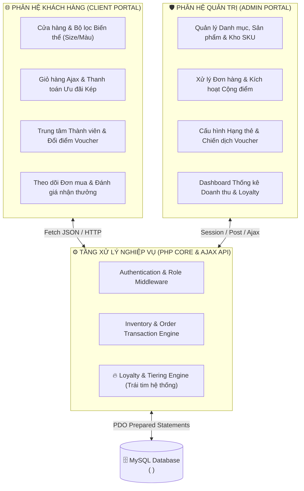
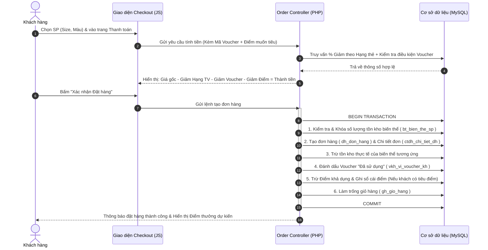
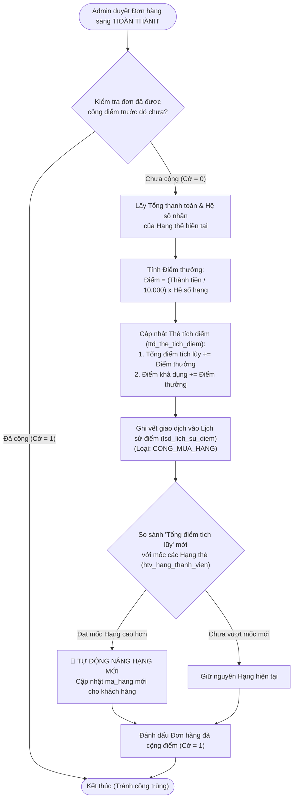
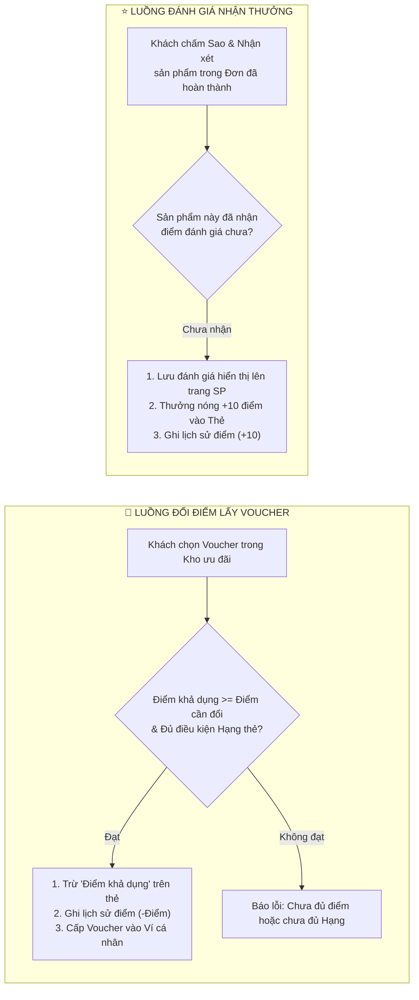

# 🛍️ FASHION LOYALTY WEB — HỆ THỐNG BÁN HÀNG THỜI TRANG & CHƯƠNG TRÌNH KHÁCH HÀNG THÂN THIẾT


-4479A1?style=flat-square&logo=mysql&logoColor=white)
-F7DF1E?style=flat-square&logo=javascript&logoColor=black)


> **Bản Demo Thực nghiệm Đồ án Môn học**
> Hệ thống quản lý bán lẻ quần áo đa biến thể (Size/Màu sắc) tích hợp động cơ tích điểm, xét nâng hạng tự động và ví ưu đãi khách hàng thân thiết (Customer Loyalty Engine).

---

## 📖 MỤC LỤC
1. [Bối cảnh & Mục tiêu Dự án](#-1-bối-cảnh--mục-tiêu-dự-án)
2. [Kiến trúc Hệ thống & Phân hệ Chức năng](#-2-kiến-trúc-hệ-thống--phân-hệ-chức-năng)
3. [Luồng Nghiệp vụ Trọng tâm (Core Workflows)](#-3-luồng-nghiệp-vụ-trọng-tâm-core-workflows)
4. [Tổ chức Cơ sở Dữ liệu (Tổng quan)](#-4-tổ-chức-cơ-sở-dữ-liệu)
5. [Kế hoạch Triển khai Dự án (WBS 5 Phases)](#-5-kế-hoạch-triển-khai-dự-án-wbs-5-phases)
6. [Cấu trúc Mã nguồn](#-6-cấu-trúc-mã-nguồn)
7. [Hướng dẫn Cài đặt & Kịch bản Trình diễn Demo](#-7-hướng-dẫn-cài-đặt--kịch-bản-trình-diễn-demo)

---

## 🎯 1. BỐI CẢNH & MỤC TIÊU DỰ ÁN

Trong lĩnh vực bán lẻ thời trang, việc thu hút khách hàng mới tốn kém gấp nhiều lần so với việc giữ chân khách hàng cũ. Dự án này hiện thực hóa các tài liệu đặc tả (*Điểm Use Case, Điểm chức năng, Phụ lục thiết kế*) thành một ứng dụng Web hoàn chỉnh với 3 trụ cột nghiệp vụ:

* **Quản lý Biến thể Thời trang (SKU Management):** Kiểm soát giá bán, hình ảnh và tồn kho chính xác đến từng tổ hợp **Kích cỡ (S/M/L/XL)** và **Màu sắc** của mỗi mẫu quần áo.
* **Cơ chế Tích điểm Kép & Nâng hạng Tự động (Automated Loyalty Tiering):** Tách bạch giữa **Điểm xét hạng** (tích lũy trọn đời để thăng cấp Đồng $\rightarrow$ Bạc $\rightarrow$ Vàng $\rightarrow$ Kim Cương) và **Điểm khả dụng** (dùng như tiền tệ để đổi Voucher hoặc giảm trừ hóa đơn).
* **Khuyến mãi Đa tầng (Multi-layer Checkout):** Cho phép khách hàng hưởng đồng thời đặc quyền giảm giá tự động theo Hạng thẻ hiện tại kết hợp với Phiếu giảm giá (Voucher) trong ví cá nhân.

---

## 🏗️ 2. KIẾN TRÚC HỆ THỐNG & PHÂN HỆ CHỨC NĂNG

Hệ thống được thiết kế theo kiến trúc **Client-Server** sử dụng **PHP thuần kết hợp Fetch API (Ajax)** để đảm bảo trải nghiệm mượt mà không cần tải lại trang ở các thao tác giỏ hàng, lọc sản phẩm và áp dụng ưu đãi.



---

## 🔄 3. LUỒNG NGHIỆP VỤ TRỌNG TÂM (CORE WORKFLOWS)

Để đảm bảo tính chặt chẽ về mặt dữ liệu, hệ thống vận hành dựa trên **4 luồng quy trình (Workflows)** khép kín dưới đây:

### 3.1. Luồng 1: Mua sắm, Áp dụng Ưu đãi Kép & Khấu trừ Tồn kho
Quy trình từ lúc khách chọn biến thể quần áo đến khi chốt đơn hàng. Toàn bộ bước đặt hàng được bọc trong một **Database Transaction** nhằm chống tình trạng âm kho (Overselling) hoặc mất điểm oan của khách.



---

### 3.2. Luồng 2: Hoàn tất Đơn hàng $\rightarrow$ Tích điểm & Xét Nâng hạng Tự động (Loyalty Engine)
Điểm thưởng **không** được cộng ngay lúc mới đặt hàng (để tránh khách đặt ảo rồi hủy đơn), mà chỉ được kích hoạt khi Quản trị viên xác nhận đơn hàng chuyển sang trạng thái **"Hoàn thành"**.



#### 💡 Quy tắc phân tách 2 quỹ điểm (Điểm nhấn nghiệp vụ):
| Loại điểm trên thẻ | Khi hoàn tất mua hàng / Đánh giá SP | Khi khách dùng điểm đổi Voucher | Vai trò trong hệ thống |
| :--- | :---: | :---: | :--- |
| **Tổng điểm tích lũy** | **Tăng ($+$)** | **Giữ nguyên (Không trừ)** | Dùng làm thước đo duy nhất để **Xét nâng hạng thẻ** (Đồng $\rightarrow$ Bạc $\rightarrow$ Vàng $\rightarrow$ Kim Cương). |
| **Điểm khả dụng** | **Tăng ($+$)** | **Giảm ($-$)** | Đóng vai trò như "số dư ví thưởng" để khách **Đổi lấy Voucher** hoặc trừ tiền khi mua sắm. |

> *Nhờ cơ chế tách bạch này, khách hàng thoải mái tiêu "Điểm khả dụng" để đổi quà mà không bao giờ sợ bị tụt Hạng thành viên đã đạt được.*

---

### 3.3. Luồng 3: Vòng đời Đổi điểm Nhận Voucher & Đánh giá Sản phẩm


---

## 🗄️ 4. TỔ CHỨC CƠ SỞ DỮ LIỆU (TỔNG QUANg)

Cơ sở dữ liệu được chuẩn hóa **3NF**, thống nhất quy ước đặt tên **Tiền tố nhóm viết tắt + Tên bảng** để dễ dàng đối chiếu giữa Tài liệu thiết kế và Mã nguồn PHP. *(Chi tiết kiểu dữ liệu và khóa ngoại được đính kèm trong file kịch bản `database/01_schema_ .sql` và bảng Excel quản lý dự án)*.

| Phân nhóm Nghiệp vụ | Số bảng | Danh sách Bảng (Tên vật lý trong MySQL) | Trách nhiệm lưu trữ chính |
| :--- | :---: | :--- | :--- |
| **1. Tài khoản & Phân quyền** | **03** | `vt_vai_tro`, `nd_nguoi_dung`, `dc_dia_chi_kh` | Quản lý định danh, phân quyền (Admin/Staff/Khách) và sổ địa chỉ giao hàng của người dùng. |
| **2. Khách hàng Thân thiết (Loyalty Core)** | **05** | `htv_hang_thanh_vien`, `ttd_the_tich_diem`, `lsd_lich_su_diem`, `pgg_phieu_giam_gia`, `vkh_vi_voucher_kh` | Lưu cấu hình 4 bậc hạng thẻ, số dư điểm của khách, sổ cái truy vết biến động điểm, kho chiến dịch Voucher và ví Voucher cá nhân. |
| **3. Sản phẩm & Kho Thời trang** | **05** | `dm_danh_muc_sp`, `sp_san_pham`, `bt_bien_the_sp`, `ha_hinh_anh_sp`, `pnk_phieu_nhap_kho` | Quản lý cây danh mục, thông tin quần áo gốc, biến thể SKU theo Size/Màu, bộ sưu tập ảnh theo màu và lịch sử phiếu nhập kho. |
| **4. Giỏ hàng, Đơn hàng & Đánh giá** | **03** | `gh_gio_hang`, `dh_don_hang`, `ctdh_chi_tiet_dh` | Lưu giỏ hàng trực tuyến, thông tin hóa đơn (tách rõ tiền giảm Hạng thẻ & tiền giảm Voucher) và đánh giá sao sau mua hàng. |

---

## 📅 5. KẾ HOẠCH TRIỂN KHAI DỰ ÁN (WBS 5 PHASES)

Dự án được chia nhỏ thành **5 Giai đoạn (Phases)** với các gói công việc phân cấp (`1.1.1`, `3.1.2`...) được theo dõi tiến độ chi tiết trong file `Bang_Quan_Ly_Cong_Viec_Demo_Web.xlsx`:

* **Phase 1 — Khởi tạo, Chốt đặc tả & Thiết kế CSDL ( ):** Rà soát tài liệu Use Case, chốt công thức toán học cho Loyalty Engine, thiết kế sơ đồ ERD và dựng khung dự án PHP + Seed Data.
* **Phase 2 — Xây dựng Giao diện Core UI & Hệ thống Xác thực:** Thiết kế Layout responsive (Client & Admin), hoàn thiện luồng Đăng ký (tự động mở thẻ tích điểm Hạng Đồng), Đăng nhập, Phân quyền và Sổ địa chỉ Ajax.
* **Phase 3 — Phát triển Module Sản phẩm, Kho SKU & Bán hàng:** Xây dựng CRUD Danh mục, Sản phẩm, Biến thể (Size/Màu), Nhập kho cộng tồn tự động; trang lọc sản phẩm, chọn biến thể động bằng JS, Giỏ hàng và Checkout Transaction.
* **Phase 4 — Phát triển Module Khách hàng Thân thiết (Loyalty) & Khuyến mãi:** Xây dựng `loyalty_engine.php` tự động cộng điểm & nâng hạng khi hoàn tất đơn; quản lý chiến dịch Voucher, trang Thẻ thành viên điện tử, Đổi điểm nhận quà và Đánh giá sản phẩm nhận điểm.
* **Phase 5 — Báo cáo Thống kê (Dashboard), Kiểm thử & Đóng gói Demo:** Tích hợp thư viện Chart.js vẽ biểu đồ doanh thu và biểu đồ phân bổ Hạng thành viên; kiểm thử tích hợp End-to-End qua và chuẩn bị kịch bản trình chiếu báo cáo.

---

## 📂 6. CẤU TRÚC MÃ NGUỒN

```text
fashion-loyalty-web/
├── 📂 admin/# Phân hệ Quản trị (Dashboard, Quản lý SP/SKU, Kho, Đơn hàng, Hạng TV, Voucher)
├── 📂 api/# Các cổng xử lý bất đồng bộ bằng Ajax (Lọc SP, Giỏ hàng, Đổi quà, Tính tiền)
├── 📂 assets/ # Tài nguyên tĩnh (CSS, JS xử lý giao diện động, Hình ảnh sản phẩm)
├── 📂 config/ # Cấu hình kết nối PDO MySQL & Các hằng số quy đổi điểm thưởng
├── 📂 database/ # Chứa file khởi tạo (schema.sql) và dữ liệu mẫu (seed_demo.sql)
├── 📂 includes/ # Header/Footer, Middleware phân quyền & Lõi tính toán (loyalty_engine.php)
├── index.php# Trang chủ cửa hàng thời trang
├── cua_hang.php # Trang danh sách & Bộ lọc quần áo đa tiêu chí
├── chi_tiet_sp.php# Trang chi tiết sản phẩm (Chọn Size/Màu realtime)
├── gio_hang.php # Trang quản lý giỏ hàng
├── thanh_toan.php # Trang Checkout tích hợp chiết khấu Hạng thẻ & Ví Voucher
├── trung_tam_thanh_vien.php # Trang Thẻ tích điểm điện tử, Thanh tiến trình lên hạng & Đổi Voucher
└── README.md# Tài liệu tổng quan & hướng dẫn vận hành dự án
```

---

## 🚀 7. HƯỚNG DẪN CÀI ĐẶT & KỊCH BẢN TRÌNH DIỄN DEMO

### 7.1. Cài đặt nhanh trong 3 bước (XAMPP / Laragon)
1. **Đưa mã nguồn vào Web Server:** Copy thư mục dự án vào `htdocs/` (XAMPP) hoặc `www/` (Laragon).
2. **Khởi tạo Cơ sở dữ liệu:** Mở `phpMyAdmin`, tạo database tên `csdl_cua_hang_thoi_trang` (bảng mã `utf8mb4_unicode_ci`), sau đó **Import** lần lượt 2 file trong thư mục `/database`:
 * `01_schema_ .sql` (Tạo cấu trúc & ràng buộc khóa ngoại).
 * `02_seed_data_demo.sql` (Nạp sẵn dữ liệu mẫu phục vụ kịch bản báo cáo).
3. **Cấu hình kết nối:** Kiểm tra thông số trong `config/db_connect.php` và truy cập `http://localhost/fashion-loyalty-web/`.

### 7.2. Tài khoản Mẫu phục vụ Báo cáo Demo trước Giảng viên
Hệ thống đã chuẩn bị sẵn các tài khoản ở các ngưỡng điểm đặc biệt để nhóm trình diễn trực tiếp các luồng nghiệp vụ mà không mất thời gian nhập liệu thủ công:

| Vai trò | Tài khoản | Mật khẩu | Mục đích thiết kế trong Kịch bản Demo |
| :--- | :---: | :---: | :--- |
| **Quản trị viên** | `admin` | `123456` | Duyệt đơn hàng hoàn thành, nhập kho, cấu hình bậc thẻ & trình chiếu biểu đồ Dashboard. |
| **Khách Hạng Đồng (Sắp lên hạng)** | `khach_dong` | `123456` | Đang có sẵn **480 / 500 điểm**. Chỉ cần mua 1 đơn hàng $\ge 200.000\text{đ}$ và Admin bấm duyệt là **trình diễn được ngay cảnh tự động thăng cấp lên Hạng Bạc** trực tiếp trên màn hình. |
| **Khách Hạng Vàng (VIP)** | `khach_vang` | `123456` | Đang có **1.650 điểm**, dùng để Demo tính năng **Giảm giá tự động 5% Hạng Vàng + Đổi điểm lấy Voucher + Áp dụng ưu đãi kép** ở trang Checkout. |

---
*Tài liệu thuộc hồ sơ Đồ án Quản lý Dự án Phần mềm — Nhóm thực hiện.*
