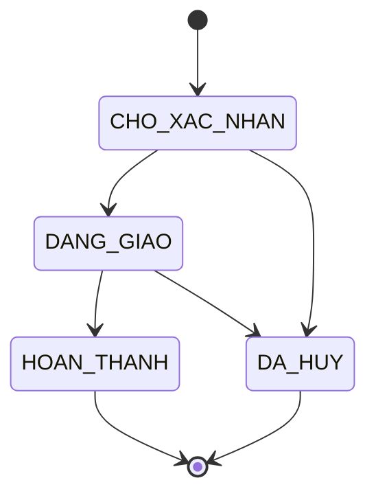
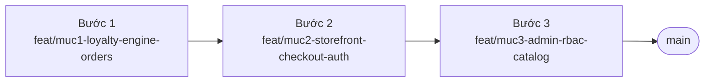

# 🚀 KẾ HOẠCH TRIỂN KHAI GIAI ĐOẠN 2

> **Mô hình phân công:** **1 Thành viên = 1 Mục Lớn Trọn Gói** (gồm nhiều mục nhỏ theo thứ tự ưu tiên logic)

## 🎯 Nguyên tắc cốt lõi

 **Thứ tự ưu tiên chặt chẽ:** Có thứ tự ưu tiên giữa 3 Mục lớn (khi gộp nhánh) và thứ tự ưu tiên bắt buộc giữa các Mục nhỏ bên trong từng người (làm lõi dữ liệu trước → làm API → nối giao diện sau).

## 📑 Mục lục

- [Phần I. Tổng quan 3 mục lớn & ranh giới file độc quyền](#phần-i-tổng-quan-3-mục-lớn--ranh-giới-file-độc-quyền)
- [Phần II. Đặc tả chi tiết từng mục lớn](#phần-ii-đặc-tả-chi-tiết-từng-mục-lớn-theo-thứ-tự-ưu-tiên-logic)
  - [🥇 Mục lớn 1 — Loyalty Engine & Đơn hàng (Thành viên 1)](#-mục-lớn-1-ưu-tiên-số-1---p1-động-cơ-khách-hàng-thân-thiết--quản-lý-đơn-hàng-trọn-gói-mục-3)
  - [🥈 Mục lớn 2 — Storefront, Giỏ hàng, Checkout & Phiên khách hàng (Thành viên 2)](#-mục-lớn-2-ưu-tiên-số-2---p2-hoàn-thiện-storefront-giỏ-hàng-checkout--phiên-khách-hàng-tinh-chỉnh-mục-1--2)
  - [🥉 Mục lớn 3 — RBAC, Bộ sưu tập ảnh theo màu & Dashboard Admin (Thành viên 3)](#-mục-lớn-3-ưu-tiên-số-3---p3-phân-quyền-vai-trò-rbac-bộ-sưu-tập-ảnh-theo-màu--dashboard-admin-tinh-chỉnh-mục-4)
- [Phần III. Quy trình gộp nhánh Git & kiểm thử nghiệm thu](#phần-iii-quy-trình-gộp-nhánh-git-merge-workflow--kiểm-thử-nghiệm-thu)

---

## PHẦN I. TỔNG QUAN 3 MỤC LỚN & RANH GIỚI FILE ĐỘC QUYỀN

### 📊 Bảng tổng hợp phân công

| Thứ tự ưu tiên | Mục lớn | Thành viên | Nhánh Git (`branch`) |
| :--- | :--- | :---: | :--- |
| 🥇 **ƯU TIÊN 1 (P1 — Trọng tâm)** | **MỤC LỚN 1:** Động cơ Khách hàng Thân thiết & Đơn hàng *(trọn gói Mục 3)* | 👤 Thành viên 1 | `feat/muc1-loyalty-engine-orders` |
| 🥈 **ƯU TIÊN 2 (P2 — Luồng Mua sắm)** | **MỤC LỚN 2:** Hoàn thiện Storefront, Giỏ hàng, Checkout & Phiên khách hàng *(tinh chỉnh Mục 1 & 2)* | 👤 Thành viên 2 | `feat/muc2-storefront-checkout-auth` |
| 🥉 **ƯU TIÊN 3 (P3 — Quản trị Admin)** | **MỤC LỚN 3:** Phân quyền vai trò (RBAC), Bộ sưu tập ảnh theo màu & Dashboard Admin *(tinh chỉnh Mục 4)* | 👤 Thành viên 3 | `feat/muc3-admin-rbac-catalog` |

### 🗂️ Các mục nhỏ bên trong (làm theo thứ tự 1 → 4)

| Mục lớn | Mục nhỏ | Nội dung |
| :---: | :---: | :--- |
| **1** | **1.1** | Lõi Loyalty Engine & Duyệt trạng thái đơn hàng (`HOAN_THANH` cộng điểm kép & nâng hạng, `DA_HUY` hoàn kho). |
| | **1.2** | Nâng cấp Quản lý Đơn hàng Admin (Hiển thị địa chỉ nhận hàng & Nút duyệt đơn). |
| | **1.3** | Đổi điểm khả dụng lấy Voucher (`TRU_DOI_VOUCHER`). |
| | **1.4** | Đánh giá sản phẩm nhận thưởng nóng +10 điểm (`CONG_DANH_GIA`). |
| **2** | **2.1** | Chuẩn hóa Session Đăng nhập / Demo Guest & Tự động bật Modal Auth. |
| | **2.2** | Mở khóa nút "+ Thêm vào giỏ" nhanh tại Trang chủ. |
| | **2.3** | Bộ lọc Voucher còn hạn thực tế & Hiển thị hạn dùng tại Checkout. |
| | **2.4** | Tự động tăng lượt xem (`luot_xem`) & Khu vực hiển thị Đánh giá tại trang Chi tiết SP. |
| **3** | **3.1** | Phân quyền cứng Admin (`ma_vt = 1`) vs Nhân viên (`ma_vt = 2`) tại Middleware. |
| | **3.2** | Khóa quyền chỉnh sửa Hạng thẻ & Chiến dịch Voucher đối với Nhân viên. |
| | **3.3** | Quản lý Bộ sưu tập ảnh phụ gắn theo màu sắc (`ha_hinh_anh_sp.mau_sac_lien_ket`). |
| | **3.4** | Hoàn thiện nút chức năng Dashboard & Cảnh báo tồn kho thấp. |

### 📁 Danh sách file độc quyền (không đụng hàng)

| 🥇 Mục lớn 1 — Thành viên 1 | 🥈 Mục lớn 2 — Thành viên 2 | 🥉 Mục lớn 3 — Thành viên 3 |
| :--- | :--- | :--- |
| `services/admin/LoyaltyEngineService.php` *(Mới)* | `config/db.php` | `admin/auth_middleware.php` |
| `api/admin_order.php` *(Mới)* | `store/pages/home.php` | `admin/tiers.php` |
| `api/redeem_voucher.php` *(Mới)* | `store/pages/product_detail.php` | `admin/vouchers.php` |
| `api/review_product.php` *(Mới)* | `store/pages/checkout.php` | `admin/products.php` |
| `services/admin/OrderAdminService.php` | `services/store/CartCheckoutService.php` | `services/admin/ProductAdminService.php` |
| `admin/orders.php` | `services/store/ProductStoreService.php` | `admin/inventory.php` |
| `services/store/LoyaltyStoreService.php` | | `services/admin/InventoryAdminService.php` |
| `store/pages/loyalty.php` | | `admin/index.php` |

---

## PHẦN II. ĐẶC TẢ CHI TIẾT TỪNG MỤC LỚN (THEO THỨ TỰ ƯU TIÊN LOGIC)

---

# 🥇 MỤC LỚN 1 (ƯU TIÊN SỐ 1 - P1): ĐỘNG CƠ KHÁCH HÀNG THÂN THIẾT & QUẢN LÝ ĐƠN HÀNG (TRỌN GÓI MỤC 3)

| Thông tin | Chi tiết |
| :--- | :--- |
| **Người phụ trách** | **Ghi tên của mình vào nhé** |
| **Nhánh Git** | `git checkout -b feat/muc1-loyalty-engine-orders` |

**Lý do xếp Ưu tiên 1:** Đây là phần nghiệp vụ cốt lõi nhất chưa được triển khai ở Giai đoạn 1. Thành viên 1 nắm trọn gói cả đầu Admin (Duyệt đơn sinh ra điểm) lẫn đầu Client (Tiêu điểm đổi Voucher & Đánh giá nhận +10 điểm) nên toàn bộ công thức tính toán Quỹ điểm Kép (`tong_diem_tich_luy` và `diem_kha_dung`) cùng sổ cái `lsd_lich_su_diem` sẽ thống nhất tuyệt đối 100%.

### 📌 Thứ tự làm việc bắt buộc của Thành viên 1 (Từ Mục 1.1 → 1.4)

> [!IMPORTANT]
> Phải làm **Mục 1.1** (Service lõi) trước tiên, sau đó nối vào **Mục 1.2** (Duyệt đơn Admin) để hiểu rõ cơ chế khóa thẻ `FOR UPDATE` và tự động nâng hạng, rồi mới làm tiếp **Mục 1.3** (Đổi Voucher) và **Mục 1.4** (Đánh giá +10 điểm).

---

### 🔹 Mục nhỏ 1.1 `[Làm đầu tiên]`: Xây dựng Lõi Động cơ Tích điểm & Chuyển trạng thái Đơn hàng
**File:** `services/admin/LoyaltyEngineService.php` & `api/admin_order.php`

#### 1️⃣ Quy tắc chuyển trạng thái đơn hàng (`dh_don_hang.trang_thai_dh`)

- Chỉ cho phép chuyển tiếp một chiều hợp lệ:
  - Từ `CHO_XAC_NHAN` → chuyển sang `DANG_GIAO` hoặc `DA_HUY`.
  - Từ `DANG_GIAO` → chuyển sang `HOAN_THANH` hoặc `DA_HUY`.
- Các đơn đã ở trạng thái `HOAN_THANH` hoặc `DA_HUY` là trạng thái đóng băng cuối cùng, từ chối mọi yêu cầu thay đổi trạng thái.



#### 2️⃣ Thuật toán khi chuyển đơn hàng sang `HOAN_THANH` (Bọc trong `PDO Transaction`)

**Bước 1 — Khóa dòng đơn hàng:**

```sql
SELECT ma_dh, ma_nd, diem_cong_du_kien, trang_thai_dh 
FROM dh_don_hang WHERE ma_dh = :ma_dh FOR UPDATE
```

**Bước 2 — Kiểm tra chống cộng trùng điểm (Idempotency):**

- Truy vấn bảng `lsd_lich_su_diem`:

  ```sql
  SELECT COUNT(*) FROM lsd_lich_su_diem 
  WHERE ma_dh = :ma_dh AND loai_giao_dich = 'CONG_MUA_HANG'
  ```

- Nếu kết quả > 0 (đã từng cộng điểm cho đơn này rồi), tuyệt đối không cộng lại lần 2.

**Bước 3 — Khóa thẻ & Cộng điểm Kép vào `ttd_the_tich_diem`:**

- Khóa dòng thẻ tích điểm của khách hàng:

  ```sql
  SELECT ma_the, ma_hang, tong_diem_tich_luy, diem_kha_dung 
  FROM ttd_the_tich_diem WHERE ma_nd = :ma_nd FOR UPDATE
  ```

- Nếu `diem_cong_du_kien > 0`, cộng đồng thời vào **cả 2 quỹ điểm**:

  ```text
  tong_diem_tich_luy_moi = tong_diem_tich_luy + diem_cong_du_kien
  diem_kha_dung_moi      = diem_kha_dung      + diem_cong_du_kien
  ```

**Bước 4 — Tự động xét Nâng hạng Thành viên (`htv_hang_thanh_vien`):**

- Dựa trên `tong_diem_tich_luy_moi`, tìm hạng cao nhất mà khách đạt ngưỡng:

  ```sql
  SELECT ma_hang, ten_hang FROM htv_hang_thanh_vien 
  WHERE diem_toi_thieu <= :tong_diem_moi 
  ORDER BY diem_toi_thieu DESC LIMIT 1
  ```

- Cập nhật `tong_diem_tich_luy`, `diem_kha_dung` và `ma_hang` mới vào `ttd_the_tich_diem`.

**Bước 5 — Ghi vết sổ cái `lsd_lich_su_diem`:**

```sql
INSERT INTO lsd_lich_su_diem (ma_the, ma_dh, loai_giao_dich, so_diem, mo_ta, ngay_giao_dich)
VALUES (:ma_the, :ma_dh, 'CONG_MUA_HANG', :so_diem, :mo_ta, NOW())
```

#### 3️⃣ Thuật toán khi chuyển đơn hàng sang `DA_HUY` (Hoàn kho SKU & Hoàn trả Voucher)

- Lấy danh sách sản phẩm trong đơn từ `ctdh_chi_tiet_dh` và cộng trả lại `so_luong` vào `bt_bien_the_sp.so_luong_ton`.
- Nếu đơn hàng có áp dụng mã giảm giá (`ma_vi_voucher IS NOT NULL`), cập nhật lại `vkh_vi_voucher_kh` (`trang_thai_su_dung = 0, ngay_su_dung = NULL`) để trả lại Voucher vào ví cho khách.

---

### 🔹 Mục nhỏ 1.2 `[Làm thứ hai]`: Nâng cấp Quản lý Đơn hàng Admin
**File:** `services/admin/OrderAdminService.php` & `admin/orders.php`

#### 1️⃣ Khắc phục thiếu thông tin giao hàng trong Modal Chi tiết đơn hàng (`OrderAdminService.php`)

- Cập nhật `getAllOrdersWithDetails()`: Bổ sung `LEFT JOIN dc_dia_chi_kh dc ON nd.ma_nd = dc.ma_nd AND dc.mac_dinh = 1` để lấy `nd.sdt`, `dc.ten_nguoi_nhan`, `dc.sdt_nguoi_nhan`, `dc.dia_chi_cu_the`.
- Hiển thị đầy đủ **Người nhận, Số điện thoại và Địa chỉ giao hàng** trong Modal `#orderDetailModal` tại `admin/orders.php`.

#### 2️⃣ Nối giao diện Duyệt đơn hàng thực tế (`admin/orders.php`)

- Gỡ bỏ hoàn toàn thuộc tính `data-dev-feature` trên nút **"Duyệt đơn"**.
- Hiển thị các nút hành động tương ứng với trạng thái đơn:

  | Trạng thái đơn | Nút hành động hiển thị |
  | :--- | :--- |
  | `CHO_XAC_NHAN` | **"Xác nhận & Giao hàng"** (`DANG_GIAO`) và **"Hủy đơn"** (`DA_HUY`) |
  | `DANG_GIAO` | **"Hoàn thành & Cộng điểm"** (`HOAN_THANH`) và **"Hủy đơn"** (`DA_HUY`) |

- Bấm nút sẽ gửi Fetch POST tới `../api/admin_order.php`, hiển thị thông báo rõ số điểm vừa cộng vào thẻ khách hàng (kèm thông báo nếu khách vừa thăng hạng).

---

### 🔹 Mục nhỏ 1.3 `[Làm thứ ba]`: Đổi điểm khả dụng lấy Voucher
**File:** `api/redeem_voucher.php`, `services/store/LoyaltyStoreService.php`, `store/pages/loyalty.php`

#### 1️⃣ Xây dựng API `api/redeem_voucher.php` (Bọc trong `PDO Transaction`)

- Khóa dòng thẻ tích điểm của khách (`ttd_the_tich_diem FOR UPDATE`) và dòng chiến dịch Voucher (`pgg_phieu_giam_gia FOR UPDATE`).
- Kiểm tra **5 điều kiện an toàn:**
  1. Chiến dịch đang hoạt động và còn hạn (`trang_thai = 1 AND NOW() BETWEEN ngay_bd AND ngay_kt`).
  2. Số lượng phát hành còn lại `so_luong > 0`.
  3. Khách chưa từng đổi chiến dịch này trong `vkh_vi_voucher_kh`.
  4. Hạng thẻ hiện tại của khách đạt yêu cầu (`diem_toi_thieu` của hạng khách ≥ `diem_toi_thieu` của `ma_hang_yeu_cau`).
  5. Số dư `diem_kha_dung >= diem_can_doi`.
- **Thực thi trừ điểm đúng chuẩn Quỹ điểm Kép:**
  - Chỉ trừ điểm trong cột `diem_kha_dung = diem_kha_dung - :diem_can_doi`.
  - **Tuyệt đối giữ nguyên** `tong_diem_tich_luy` và `ma_hang` (tiêu điểm đổi quà không làm tụt hạng thẻ).
- Giảm `pgg_phieu_giam_gia.so_luong` đi 1, sinh mã `ma_code_voucher` cá nhân hóa lưu vào `vkh_vi_voucher_kh`, và ghi sổ cái `lsd_lich_su_diem` với `loai_giao_dich = 'TRU_DOI_VOUCHER'`, `so_diem = -:diem_can_doi`.

#### 2️⃣ Nối giao diện Đổi Voucher tại `store/pages/loyalty.php`

- Gỡ bỏ `data-dev-feature="Đổi điểm lấy mã giảm giá (Voucher)"` ở nút **"Đổi ngay"**.
- Gắn sự kiện gọi `api/redeem_voucher.php`, hiển thị Toast mã Voucher vừa nhận và tự động làm mới số dư Điểm khả dụng cùng Ví Voucher.

---

### 🔹 Mục nhỏ 1.4 `[Làm thứ tư]`: Đánh giá Sản phẩm Nhận thưởng nóng +10 Điểm
**File:** `api/review_product.php`, `services/store/LoyaltyStoreService.php`, `store/pages/loyalty.php`

#### 1️⃣ Xây dựng API `api/review_product.php` (Bọc trong `PDO Transaction`)

- Nhận `ma_ctdh`, `so_sao` (từ 1 → 5), `noi_dung_danh_gia`.
- Khóa dòng `ctdh_chi_tiet_dh` nối với `dh_don_hang FOR UPDATE`.
- Kiểm tra: Đơn hàng phải thuộc về chính khách hàng đang đăng nhập (`dh.ma_nd == $currentUserId`), trạng thái đơn phải là `HOAN_THANH`, và dòng chi tiết đó chưa từng được cộng điểm đánh giá (`da_cong_diem_dg == 0`).
- **Thực thi:**
  - Cập nhật `so_sao`, `noi_dung_danh_gia`, `ngay_danh_gia = NOW()`, `da_cong_diem_dg = 1` vào `ctdh_chi_tiet_dh`.
  - Cộng nóng **+10 điểm** vào **cả 2 quỹ điểm** (`tong_diem_tich_luy` và `diem_kha_dung`) trong `ttd_the_tich_diem`, đồng thời kiểm tra nâng hạng tự động nếu +10 điểm này giúp khách vượt mốc hạng mới.
  - Ghi sổ cái `lsd_lich_su_diem` với `loai_giao_dich = 'CONG_DANH_GIA'`, `so_diem = 10`, `ma_dh = :ma_dh`.

#### 2️⃣ Bổ sung Giao diện Đánh giá nhận +10 điểm trong `store/pages/loyalty.php`

- Mở rộng `LoyaltyStoreService::getUserOrders()` để lấy danh sách từng sản phẩm (`ma_ctdh`, `ten_sp`, `size`, `mau_sac`, `so_sao`, `da_cong_diem_dg`) trong đơn hàng.
- Tại bảng Lịch sử đơn hàng ở `store/pages/loyalty.php`: Với các đơn `HOAN_THANH`, hiển thị nút **"⭐ Đánh giá (+10 điểm)"** bên cạnh sản phẩm có `da_cong_diem_dg == 0` và mở Modal chấm sao gửi tới `api/review_product.php`.

---

# 🥈 MỤC LỚN 2 (ƯU TIÊN SỐ 2 - P2): HOÀN THIỆN STOREFRONT, GIỎ HÀNG, CHECKOUT & PHIÊN KHÁCH HÀNG (TINH CHỈNH MỤC 1 & 2)

| Thông tin | Chi tiết |
| :--- | :--- |
| **Người phụ trách** | **Ghi tên của mình vào nhé**  |
| **Nhánh Git** | `git checkout -b feat/muc2-storefront-checkout-auth` |

**Lý do xếp Ưu tiên 2:** Phụ trách toàn bộ luồng trải nghiệm mua sắm của khách hàng ở mặt tiền cửa hàng (Storefront), khắc phục triệt để các điểm đứt gãy từ phiên đăng nhập, trang chủ, trang chi tiết sản phẩm cho đến bước thanh toán.

### 📌 Thứ tự làm việc bắt buộc của Thành viên 2 (Từ Mục 2.1 → 2.4)

> [!IMPORTANT]
> Phải chuẩn hóa **Mục 2.1** (Session & Auth) trước, sau đó làm **Mục 2.2** (Thêm giỏ hàng nhanh ở Trang chủ), tiếp theo là **Mục 2.3** (Bộ lọc Voucher còn hạn ở Checkout) và cuối cùng là **Mục 2.4** (Lượt xem & Hiển thị đánh giá ở Chi tiết sản phẩm).

---

### 🔹 Mục nhỏ 2.1 `[Làm đầu tiên]`: Chuẩn hóa Phiên Đăng nhập / Demo Guest
**File:** `config/db.php`

#### 1️⃣ Khắc phục bất nhất giữa `getCurrentUserId()` và `isUserLoggedIn()` trong `config/db.php`

- Đảm bảo khi hệ thống khởi tạo phiên mặc định (`current_user_id = 4` khi chưa bấm Logout), trạng thái phiên làm việc đồng bộ trên toàn bộ `api/address.php`, `api/cart.php` và `api/checkout.php`.
- Khi người dùng đã chủ động bấm **Đăng xuất** (`explicit_logout = true`, `current_user_id = 0`), hàm `isUserLoggedIn()` trả về `false` chuẩn xác để Header hiện nút **"Đăng nhập"**.

#### 2️⃣ Tự động mở Modal Đăng nhập khi khách chưa đăng nhập bấm Mua hàng

- Tại `store/pages/product_detail.php` và `store/pages/home.php`: Khi gọi `window.cartAPI.add()` mà nhận về `res.require_login === true`, tự động kích hoạt `window.openAuthModal('login')` để khách đăng nhập ngay mà không phải tìm nút trên thanh menu.

---

### 🔹 Mục nhỏ 2.2 `[Làm thứ hai]`: Mở khóa Nút "+ Thêm vào giỏ" Nhanh tại Trang chủ
**File:** `store/pages/home.php`

#### 1️⃣ Vị trí cần xử lý trong `store/pages/home.php`

- **Khu vực 1:** Gợi ý riêng cho bạn (Dòng 45).
- **Khu vực 2:** Lưới sản phẩm chính (Dòng 177).

#### 2️⃣ Cách triển khai chi tiết

- Duyệt mảng `$p['variants']` của từng sản phẩm để lấy biến thể đầu tiên còn tồn kho (`so_luong_ton > 0`).
- Xóa bỏ thuộc tính `data-dev-feature="Thêm nhanh sản phẩm vào giỏ hàng"`.
- Thay bằng `data-ma-bt="<?= (int)$availableVariant['ma_bt'] ?>"` và class `.js-home-add-to-cart`. Nếu tất cả biến thể đều có `so_luong_ton <= 0`, đổi nút thành `"Hết hàng"` (`disabled`).
- Bổ sung sự kiện click gọi `window.cartAPI.add(maBt, 1)` → Khi thành công sẽ tự động cập nhật badge số lượng trên Header và mở ngăn kéo giỏ hàng (`window.openCartDrawer()`).

---

### 🔹 Mục nhỏ 2.3 `[Làm thứ ba]`: Lọc Voucher Hết hạn & Tinh chỉnh Giao diện Thanh toán
**File:** `services/store/CartCheckoutService.php` & `store/pages/checkout.php`

#### 1️⃣ Cập nhật truy vấn trong `CartCheckoutService::getCustomerAvailableVouchers(int $maNd)`

- Bổ sung điều kiện kiểm tra thời hạn chiến dịch trực tiếp vào câu SQL:

  ```sql
  WHERE vkh.ma_nd = :ma_nd
    AND vkh.trang_thai_su_dung = 0
    AND pgg.trang_thai = 1
    AND NOW() BETWEEN pgg.ngay_bd AND pgg.ngay_kt
  ORDER BY pgg.gia_tri_giam DESC
  ```

- Việc này đảm bảo những Voucher đã quá hạn `ngay_kt` hoặc vừa bị Admin bấm **"Kết thúc sớm"** sẽ biến mất ngay khỏi danh sách chọn ở trang Checkout, không để khách chọn nhầm rồi bị lỗi lúc bấm Đặt hàng.

#### 2️⃣ Nâng cấp hiển thị ở `store/pages/checkout.php`

- Hiển thị thêm thông tin `(Đơn tối thiểu: ...đ | HSD: dd/mm/yyyy)` ngay trên từng dòng `<option>` của `#voucherSelect`.

---

### 🔹 Mục nhỏ 2.4 `[Làm thứ tư]`: Tự động Tăng Lượt xem (`luot_xem`) & Hoàn thiện Trang Chi tiết Sản phẩm
**File:** `services/store/ProductStoreService.php` & `store/pages/product_detail.php`

#### 1️⃣ Tự động cộng +1 lượt xem (`ProductStoreService.php`)

- Bổ sung phương thức `incrementViewCount(int $maSp)` thực thi câu lệnh:

  ```sql
  UPDATE sp_san_pham SET luot_xem = luot_xem + 1 WHERE ma_sp = :ma_sp
  ```

- Gọi hàm này trong `store/pages/product_detail.php` mỗi khi khách xem sản phẩm hợp lệ, giúp bảng xếp hạng *"Gợi ý riêng cho bạn"* ở trang chủ cập nhật đúng độ hot thực tế.

#### 2️⃣ Hiển thị thông báo nhắc nhận +10 điểm đánh giá tại `store/pages/product_detail.php`

- Kiểm tra nếu khách hiện tại đã mua sản phẩm này trong một đơn `HOAN_THANH` mà vẫn còn dòng `da_cong_diem_dg = 0`, hiển thị một banner nhỏ ngay đầu khu vực Đánh giá:

  > *"🎁 Bạn đã mua sản phẩm này! Hãy vào Trung tâm Thành viên để đánh giá và nhận ngay +10 điểm thưởng."*

  kèm nút dẫn sang `index.php?page=loyalty`.

---

# 🥉 MỤC LỚN 3 (ƯU TIÊN SỐ 3 - P3): PHÂN QUYỀN VAI TRÒ (RBAC), BỘ SƯU TẬP ẢNH THEO MÀU & DASHBOARD ADMIN (TINH CHỈNH MỤC 4)

| Thông tin | Chi tiết |
| :--- | :--- |
| **Người phụ trách** | 👤 **Ghi tên của mình vào nhé**  |
| **Nhánh Git** | `git checkout -b feat/muc3-admin-rbac-catalog` |

**Lý do xếp Ưu tiên 3:** Phụ trách toàn bộ mảng Quản trị cấu hình hệ thống, bảo mật phân quyền giữa Quản trị viên và Nhân viên, quản lý hình ảnh sản phẩm nâng cao và bảng điều khiển tồn kho.

### 📌 Thứ tự làm việc bắt buộc của Thành viên 3 (Từ Mục 3.1 → 3.4)

> [!IMPORTANT]
> Phải xây dựng hàm kiểm tra quyền ở **Mục 3.1** (`auth_middleware.php`) trước tiên, sau đó áp dụng khóa phân quyền vào **Mục 3.2** (`tiers.php` & `vouchers.php`), rồi mới nâng cấp tiếp **Mục 3.3** (Bộ sưu tập ảnh theo màu ở `products.php`) và **Mục 3.4** (`index.php` & `inventory.php`).

---

### 🔹 Mục nhỏ 3.1 `[Làm đầu tiên]`: Xây dựng Cơ chế Phân quyền RBAC Admin vs Nhân viên
**File:** `admin/auth_middleware.php`

#### 1️⃣ Bổ sung các hàm kiểm tra vai trò vào `admin/auth_middleware.php`

- Theo thiết kế bảng `vt_vai_tro`:

  | `ma_vt` | Vai trò | Quyền hạn |
  | :-: | :--- | :--- |
  | `1` | **Quản trị viên — Admin** | Toàn quyền cấu hình hệ thống, hạng thành viên, chiến dịch khuyến mãi và thống kê doanh thu. |
  | `2` | **Nhân viên — Staff** | Chỉ quản lý sản phẩm, lập phiếu nhập kho và xử lý đơn hàng. |

- Viết hàm helper dùng chung:

  ```php
  function isSuperAdminRole(): bool {
      global $adminCurrentUser;
      return isset($adminCurrentUser['ma_vt']) && (int)$adminCurrentUser['ma_vt'] === 1;
  }
  ```

---

### 🔹 Mục nhỏ 3.2 `[Làm thứ hai]`: Khóa Quyền Chỉnh sửa Hạng thẻ & Chiến dịch Voucher đối với Nhân viên
**File:** `admin/tiers.php` & `admin/vouchers.php`

#### 1️⃣ Tại `admin/tiers.php` (Cấu hình Hạng thành viên)

- Ở khối xử lý `if ($_SERVER['REQUEST_METHOD'] === 'POST')`: Kiểm tra `if (!isSuperAdminRole())`, lập tức chặn lại, gán `setAdminFlash('error', 'Truy cập bị từ chối: Chỉ Quản trị viên (Admin) mới được phép thay đổi cấu hình Hạng thành viên!')` và `header('Location: tiers.php'); exit;`.
- Trên giao diện bảng Hạng thẻ: Nếu `!isSuperAdminRole()`, ẩn nút **"Chỉnh sửa"** và hiển thị nhãn *"Chế độ chỉ xem (Nhân viên)"*.

#### 2️⃣ Tại `admin/vouchers.php` (Chiến dịch Khuyến mãi & Phát hành Voucher)

- Ở khối xử lý `if ($_SERVER['REQUEST_METHOD'] === 'POST')`: Kiểm tra `if (!isSuperAdminRole())`, chặn mọi thao tác tạo mới hoặc kết thúc sớm chiến dịch, báo lỗi Flash Toast và redirect.
- Trên giao diện `admin/vouchers.php`: Nếu `!isSuperAdminRole()`, ẩn nút **"+ Phát hành Voucher mới"** và nút **"Kết thúc sớm"**.

---

### 🔹 Mục nhỏ 3.3 `[Làm thứ ba]`: Quản lý Bộ sưu tập Ảnh phụ Gắn theo Màu sắc
**File:** `services/admin/ProductAdminService.php` & `admin/products.php`

#### 1️⃣ Mở rộng `services/admin/ProductAdminService.php`

- Bổ sung phương thức `addProductGalleryImages(int $maSp, array $files, string $mauSacLienKet)` và `deleteGalleryImage(int $maAnh, int $maSp)`:
  - Cho phép tải lên thêm các ảnh phụ lưu vào bảng `ha_hinh_anh_sp` với cột `mau_sac_lien_ket` (ví dụ: `Đen`, `Trắng`, `Kem`, `Xanh`) và `la_anh_chinh = 0`.

#### 2️⃣ Nâng cấp Giao diện `admin/products.php`

- Trong Modal Chỉnh sửa sản phẩm (hoặc Modal Quản lý Ảnh riêng cho từng sản phẩm), hiển thị danh sách các ảnh hiện có trong `ha_hinh_anh_sp` của sản phẩm đó, cho phép chọn tên màu sắc liên kết (`mau_sac_lien_ket`) khi tải ảnh lên và xóa ảnh phụ không còn dùng.

---

### 🔹 Mục nhỏ 3.4 `[Làm thứ tư]`: Hoàn thiện Dashboard Tổng quan & Cảnh báo Tồn kho SKU
**File:** `admin/index.php`, `admin/inventory.php`, `services/admin/InventoryAdminService.php`

#### 1️⃣ Tại `admin/index.php` (Trang Tổng quan Dashboard)

- Gỡ bỏ thuộc tính `data-dev-feature` ở nút **"Làm mới dữ liệu"** (chuyển thành tải lại số liệu thực tế `window.location.reload()`).
- Bổ sung bảng nhỏ hoặc thẻ cảnh báo nhanh **"Biến thể SKU sắp hết hàng (`so_luong_ton <= 5`)"** kèm đường dẫn bấm sang `inventory.php` để nhập hàng kịp thời.

#### 2️⃣ Tại `admin/inventory.php` & `services/admin/InventoryAdminService.php`

- Bổ sung bộ lọc nhanh trên bảng Tồn kho SKU (Lọc theo: *Tất cả* / *Sắp hết hàng* (≤ 5) / *Đã hết hàng* (= 0)) để Nhân viên kho dễ dàng lập phiếu nhập hàng.

---

## PHẦN III. QUY TRÌNH GỘP NHÁNH GIT (MERGE WORKFLOW) & KIỂM THỬ NGHIỆM THU

Nhờ việc chia theo **3 Mục Lớn Độc Lập File**, quy trình gộp code về nhánh `main` sẽ diễn ra cực kỳ an toàn theo thứ tự ưu tiên sau:



| Bước | Nhánh cần merge | Phụ trách | Nội dung đưa vào `main` |
| :-: | :--- | :---: | :--- |
| **1** | `feat/muc1-loyalty-engine-orders` *(Ưu tiên 1)* | 👤 Thành viên 1 | Toàn bộ động cơ Loyalty Engine, Duyệt đơn hàng, Đổi Voucher và Đánh giá +10 điểm. |
| **2** | `feat/muc2-storefront-checkout-auth` *(Ưu tiên 2)* | 👤 Thành viên 2 | Toàn bộ nâng cấp Trang chủ, Giỏ hàng nhanh, Bộ lọc hạn Voucher Checkout và Lượt xem sản phẩm. |
| **3** | `feat/muc3-admin-rbac-catalog` *(Ưu tiên 3)* | 👤 Thành viên 3 | Toàn bộ Phân quyền Admin/Staff, Quản lý bộ sưu tập ảnh theo màu và Cảnh báo tồn kho. |
